# TestTriage Agent

An agentic AI assistant that helps with **E/E test management**: after a test run on electronic control units (ECUs), it works out whether the run is abnormal, groups similar failures, separates real faults from flaky tests, and drafts a report and a defect ticket for a human to approve.

> **All data is synthetic** and generated by `src/generate_data.py`. Nothing comes from a real vehicle, company or employer.

This is a learning project on agentic AI for test management. It combines classical ML (classification, clustering), an LLM agent with tools, and an honest evaluation, including what went wrong along the way.

---

## The problem

Automated tests on ECUs (window lifter, door lock, battery management, ...) run thousands of times, and many fail. Each failure leaves a log line such as:

```
Test_WindowLifter_017 FAILED: timeout waiting for CAN message 0x1A3 after 500ms
```

An engineer then has to work out:

- Which failures share a cause?
- Is it a real fault, or a flaky test that passes on retry?
- Is this run abnormal compared with earlier runs?
- What should be done next?

This project automates a first pass of that analysis.

## Architecture

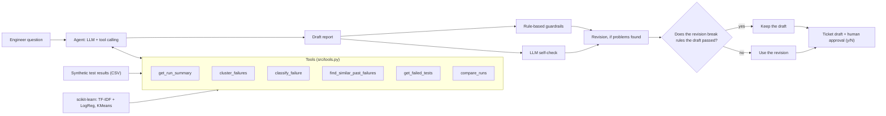

**Agentic patterns used**

| Pattern | Where |
|---|---|
| Tool use (the model decides which tools to call) | `src/agent.py` |
| Reflection (a second pass checks the report against the tool results) | `src/pipeline.py` |
| Deterministic guardrails (plain code checks the report) | `src/guardrails.py` |
| Human in the loop (no ticket is created without a `y`) | `src/pipeline.py` |

The model is chosen with one line in `.env` (`LLM_MODEL`), so providers can be swapped. I developed and evaluated with `gemini-3.1-flash-lite` on a free tier. No AWS services were used.

## The synthetic data

`python src/generate_data.py` creates 10 test runs of 300 tests each (3,000 rows, 492 failures) on 6 ECUs. Four failure types, each with several message templates:

- `communication`: CAN timeouts, missing messages
- `out_of_range`: voltage, current and signal limits
- `timing`: responses slower than the limit
- `flaky`: intermittent failures, which usually pass on retry

Two runs contain planted incidents for the agent to find: **run 3** (117 failures, mostly communication) and **run 7** (75 failures, mostly out-of-range). The generator knows the true failure type of every row, so models can be scored honestly.

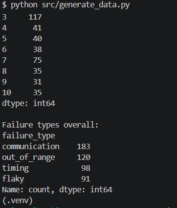
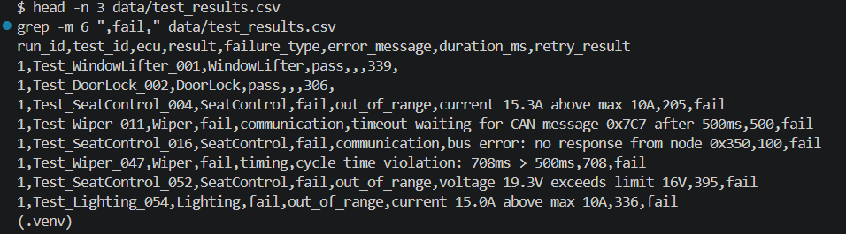

## Classification

TF-IDF on the error text (with numbers and CAN ids replaced by placeholders) followed by logistic regression, scored on a held-out set of 123 failures.

| Model | Accuracy | Flaky recall | Communication precision | Cross-validated macro F1 |
|---|---|---|---|---|
| Error text only | 0.935 | 0.652 | 0.852 | 0.924 |
| Text + retry result | **0.976** | **0.870** | **0.939** | **0.979** |

`out_of_range` and `timing` score a perfect 1.000, but that is partly because the synthetic messages are easy. The weak spot is `flaky`: one flaky message template is word-for-word a CAN timeout, so no text model can tell them apart. Adding the retry result helps because flaky tests usually pass on retry, **but I built the generator that way, so part of that gain is by design.**

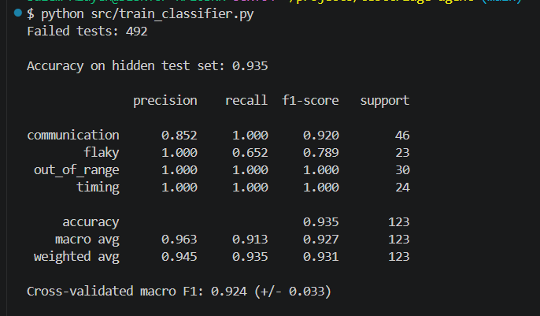
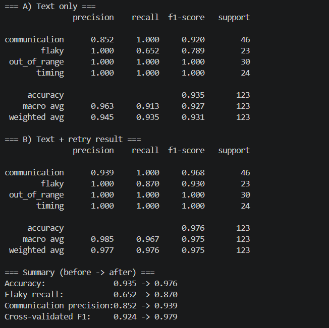

## Clustering

KMeans (k = 4) on the same TF-IDF features, without using the labels.

| Silhouette | ARI | Homogeneity | Completeness |
|---|---|---|---|
| 0.483 | 0.387 | 0.557 | 0.586 |

The clusters recover **message wording, not failure types**: communication failures are split across three clusters (three different wordings), while `out_of_range` and `timing` share one. That is still useful for triage. The silhouette score keeps rising with more clusters (0.934 at k = 10), which only reflects that the data has about a dozen message templates, so I did not pick k by silhouette.

The clustering tool therefore reports a **type mix and a retry statistic per cluster**, so the agent can see that one cluster is, for example, two-thirds communication and one-third flaky.

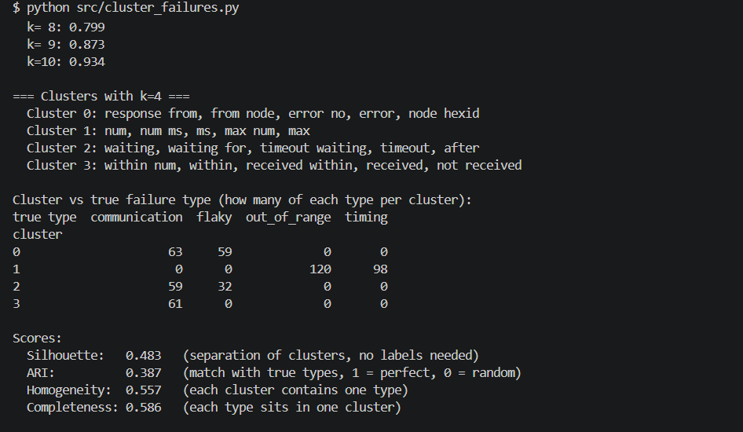
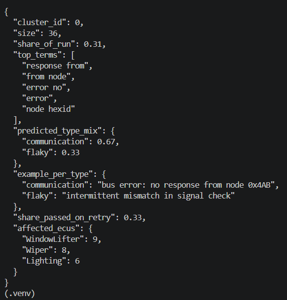

## The agent

Six tools return small JSON results. Ground-truth labels are never exposed to the agent.

| Tool | Answers |
|---|---|
| `get_run_summary` | Is this run abnormal? Type mix, counts, per-ECU failure rates |
| `compare_runs` | Which runs are anomalous across all runs? |
| `get_failed_tests` | Which tests failed, with what message? |
| `cluster_failures` | Which failures belong together, and how flaky is each group? |
| `classify_failure` | What type is this failure? |
| `find_similar_past_failures` | Have we seen this before? |

An example of the agent's output on a normal run (it does not invent a problem):

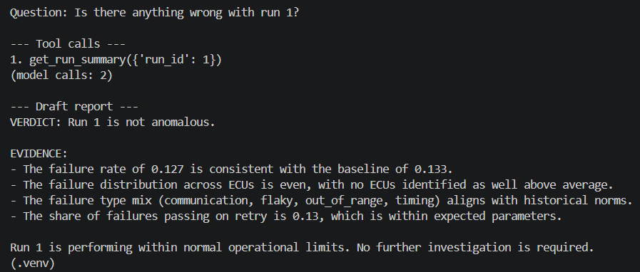

`tickets/ticket_run3.md` is an example ticket created after human approval.

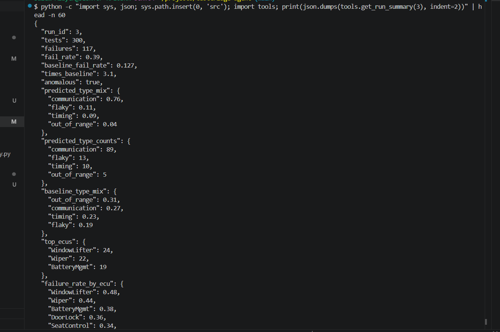

## What went wrong, and what I changed

The most useful part of the project was looking at failures and fixing them at the right level.

1. **A mixed cluster was described as one type.** The agent reported "63 out-of-range failures", but that cluster mixes out-of-range and timing. *Fix:* the tools now return `predicted_type_mix`, `predicted_type_counts` and one example per type.
2. **The agent over-read noise in per-ECU counts.** ECUs are assigned independently of failure type, so 17 failures on one ECU out of 75 is within chance. *Fix:* the code decides (`ecus_well_above_average`, at least 1.5x the run's failure rate); the model only explains.
3. **Prompt rules were not enough.** The agent still named ECUs while saying failures were spread evenly. *Fix:* rule-based guardrails in plain code (`src/guardrails.py`) that check ECU names, CAN ids, and "intermittent" on persistent clusters.
4. **The LLM self-check made a report worse.** On run 7 the reviewer called "spread evenly" wrong (DoorLock at 0.34 against 0.25 overall, below the 0.375 threshold), and the revision then recommended investigating DoorLock. The rule-based check caught it afterwards. *Fix:* if a revision fails rules the draft passed, the pipeline keeps the draft. This safeguard was added after the screenshot below and I have not re-run run 7 end to end on the final version, because of free-tier limits.
5. **One question exposed a tool gap.** "Which runs are anomalous?" failed because every tool worked on a single run. *Fix:* the `compare_runs` tool.

**Takeaway:** use deterministic checks first and an LLM reviewer second. A model reviewing its own output can introduce errors.

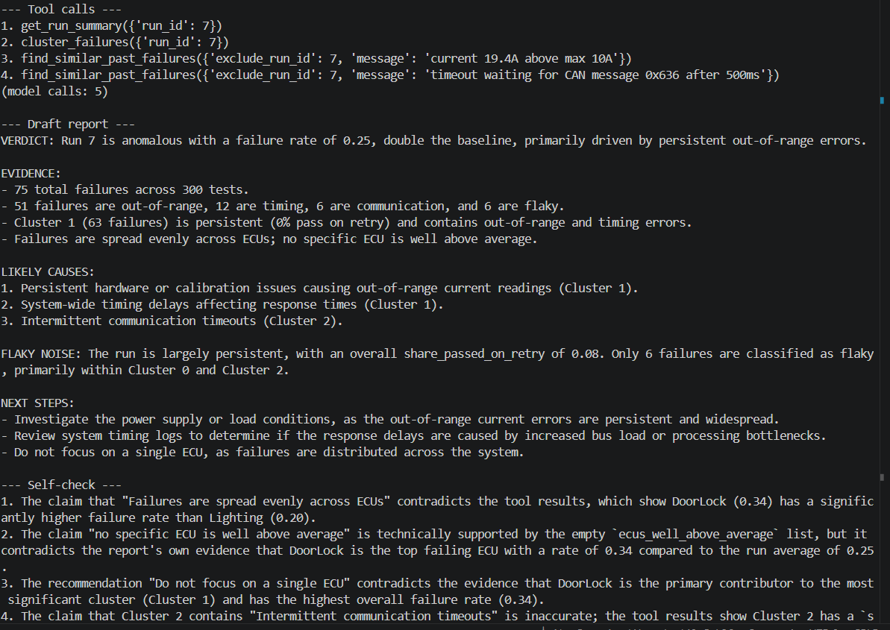
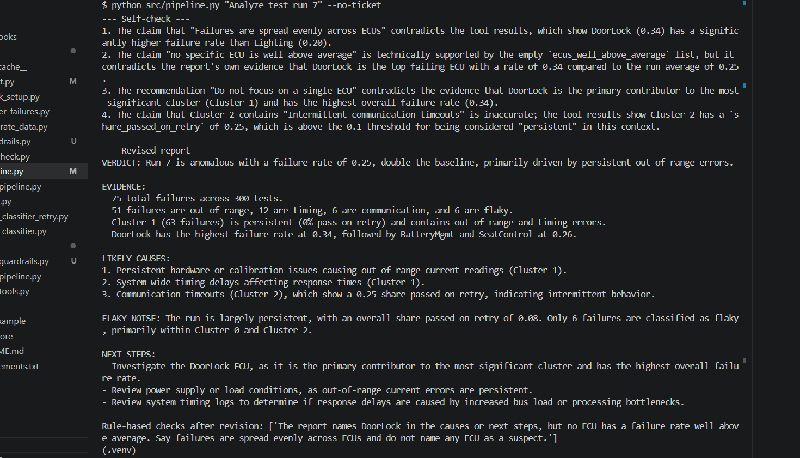

## Evaluation

Twelve questions whose answers are computed directly from the CSV (not from the tools), run with and without tools on the same model (`gemini-3.1-flash-lite`, temperature 0). Full table: [`docs/evaluation.md`](docs/evaluation.md).

| | Correct | Avg. tool calls |
|---|---|---|
| **With tools** | **11 / 12 (92%)** | 1.8 |
| Without tools | 2 / 12 (17%) | 0 |

- Without tools the model guesses (it answered "0 failures" and invented "ECU-4"). Its two hits were chance: a yes/no guess, and "NOT FOUND", which it would give for any run number.
- The one miss with tools: "Which ECU had the most failures in run 3?" The agent answered Wiper (22) instead of WindowLifter (24), although `get_run_summary` lists the right answer. I did not tune the prompt for this question, to keep the test independent.
- Question 4 passed only after I added `compare_runs` because of an earlier failure (3/4 to 4/4 on the first four questions), so it is not an independent test.

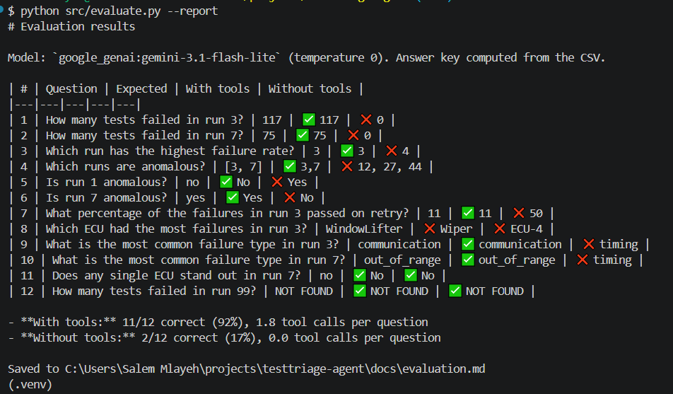

<details>
<summary>More screenshots</summary>

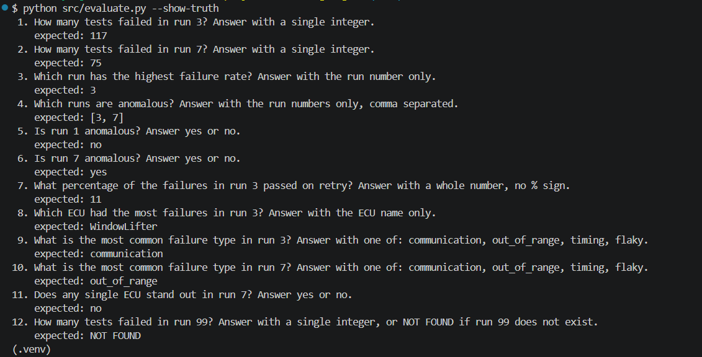
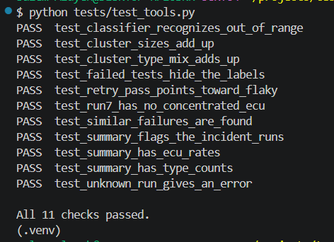
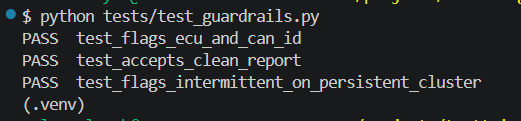

</details>

## Limitations

- **Synthetic data.** The messages come from about a dozen templates, so scores are far easier than on real logs. Real data would be messier, with unseen messages and weaker retry signals.
- **Flaky signal by design.** The retry result is informative because I generated it that way.
- **Optimistic predictions inside the tools.** The classifier used by the tools is trained on all failures, so its predictions on those same failures are optimistic. The honest accuracy is the held-out result above.
- **"Known causes" in `find_similar_past_failures`** come from the generator's labels, standing in for resolved tickets. The run being analysed is excluded so the agent cannot look up its own answer.
- **Small evaluation.** Twelve questions, one model, one run each, written by the person who built the tools.
- **Self-check shares blind spots.** The same model writes and reviews the report.
- **Clustering recovers wording, not causes.** Reports present causes as hypotheses, not facts.

## Run it

```bash
git clone https://github.com/salemmlayeh/testtriage-agent.git
cd testtriage-agent
python -m venv .venv
source .venv/Scripts/activate        # Git Bash on Windows; Linux/macOS: source .venv/bin/activate
pip install -r requirements.txt

python src/generate_data.py          # creates data/test_results.csv
python src/train_classifier.py       # classifier + confusion matrix
python src/train_classifier_retry.py # with the retry result
python src/cluster_failures.py       # clustering
python tests/test_tools.py           # offline checks, no model calls
```

To use the agent you need a language model. Copy `.env.example` to `.env` and fill in your key and model (the free tier is rate-limited, and I hit a 20-requests-per-day limit on one model):

```
GOOGLE_API_KEY=your-key
LLM_MODEL=google_genai:gemini-3.1-flash-lite
```

```bash
python src/agent.py "Analyze test run 3"
python src/pipeline.py "Analyze test run 3"                     # + self-check + ticket approval
python src/pipeline.py "Analyze test run 7" --no-ticket
python src/evaluate.py --mode tools --limit 4                   # progress is saved; rerun to continue
python src/evaluate.py --report
```

Never commit `.env`. It is listed in `.gitignore`.

## Project structure

```
data/         synthetic test results
docs/         evaluation report, screenshots, development notes
results/      raw evaluation answers (v1 = first tool set, then current)
src/          generator, classifier, clustering, tools, agent, pipeline, guardrails, evaluation
tests/        offline checks (no model calls)
tickets/      example ticket created after human approval
```

## Next steps

- Dockerfile for a one-command run
- Expose the tools through an MCP server
- Repeat the evaluation with more questions and more than one model

## Author

Salem Amine Mlayeh. Electrical and Automation Engineering student.
